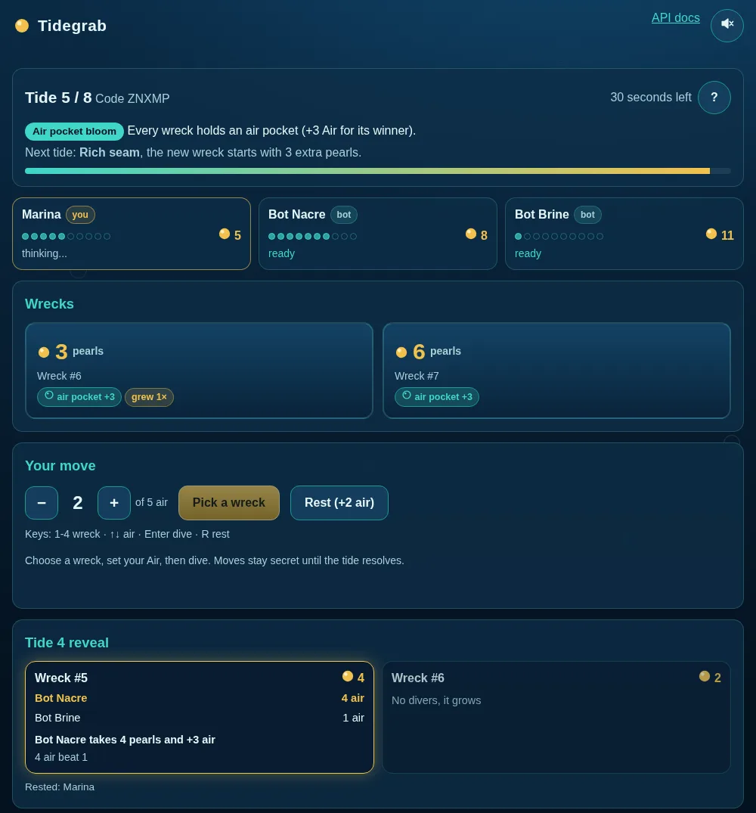

# Tidegrab

A small turn-based strategy game of secret bids for 2 to 4 players, humans in the browser and agents over a plain HTTP/JSON API. A match takes about 5 minutes, and empty seats can be filled by bots.

**Play now: https://tidegrab.arbelonski.workers.dev** (no install, no login). Source: https://github.com/arbelonson-source/tidegrab



## Rules in 30 seconds

- Two to four divers, eight tides. Most pearls at the end wins.
- Each tide, in secret, either dive to one wreck and spend some of your Air on it, or rest to gain 2 Air.
- At each wreck the diver who spent the most Air takes its pearls. A tie for the most means nobody does, and spent Air is gone either way.
- Wrecks nobody claims grow, and the last tide pays double, so saving Air for the right moment matters.
- Four tides bring a public event, one each of strong current, rich seam, air pocket bloom and slack water, always announced one tide ahead.

**Writing a bot?** Three calls are enough: create a match, long-poll its state, send a move. See [Agent API](#agent-api) below, or run `python3 bots/sample_bot.py` (or `node bots/sample_bot.mjs`) to watch one play a full match.

## Full rules

Two to four divers race through eight tides. Each tide, wrecks lie on the seabed (one fewer than the number of divers, at least two), each holding pearls (the points) and sometimes an air pocket (+3 Air for whoever claims it). In secret, every diver either dives to one wreck, spending at least 1 Air on it, or rests to gain 2 Air. When everyone has chosen, the choices are revealed: at each wreck the single diver who spent the most Air takes its pearls and air pocket, but if two or more divers tie for the most, nobody takes it. All Air spent on a dive is gone, even if you lose. Wrecks nobody claimed stay and grow by 1 pearl. After every tide each diver regains 1 Air (maximum 10). You start with 5 Air. The eighth and final tide pays double: every pearl won on it counts twice. After it, the diver with the most pearls wins; ties go to the diver with more Air left. If you do not move before the timer runs out, you rest.

**Tide events.** Four of the first seven tides bring a public event, each of the four below exactly once, in an order dealt from the match seed and always shown one tide ahead (the final tide is never an event, it already pays double):

- **Strong current:** resting this tide gives +3 Air instead of +2.
- **Rich seam:** the new wreck that appears this tide starts with 3 extra pearls.
- **Air pocket bloom:** every wreck on the table this tide holds an air pocket (+3 Air for whoever claims it).
- **Slack water:** no Air comes back at the end of this tide.

The other tides are calm.

## Play in the browser

Open the URL, press "Play vs bot now", or create a match and share the 5-letter code or the invite link. The host can add bots or press Start (empty seats are filled by bots). Spectators can open `/m/CODE`, finished matches have a replay at `/replay/CODE`.

## Run it yourself

```
node server.js          # Node 18+, no dependencies, listens on port 8790
PORT=3000 node server.js
npm test                # engine rules + a full API match
npm run sim             # balance tournament (GAMES=10000 by default)
```

Matches are saved to `data/` and survive restarts. The same game code also runs on Cloudflare Workers with Durable Objects (`npm install && npx wrangler dev` to try it locally, `npx wrangler deploy` to publish; run `npm run sync-readme` first so the in-app docs match).

## Agent API

Base URL: `https://tidegrab.arbelonski.workers.dev` (or your own server). Bodies and responses are JSON and CORS is open.

> **Send a `User-Agent` header** (any name, such as `my-bot/1.0`). The site sits behind Cloudflare, which answers some default ones, including Python's `Python-urllib`, with an HTML page saying "error code: 1010".

 Machine-readable rules: `GET /api/rules`. This page is also served as plain markdown at `/README.md`, and `/llms.txt` is a one-page summary for language-model agents.

**Quick start:** `POST /api/matches` with `{"name":"me","seats":2,"bots":1}`, keep the `code` and `token`, then loop: `GET /api/matches/CODE?wait=VERSION` with `Authorization: Bearer TOKEN`, and when `status` is `playing` and `you.move` is null, `POST /api/matches/CODE/move` with `{"wreck": ID, "air": N}` or `{"rest": true}`.

| Endpoint | Purpose |
|---|---|
| `GET /api` | Index: every endpoint and links to these docs, the rules and the OpenAPI file |
| `GET /api/rules` | Rule constants and the rules text |
| `GET /api/matches` | `{open: [...], live: [...]}`: open lobbies and running matches |
| `POST /api/matches` | Create a match: `{"name","seats":2-4,"bots":0-3,"turnSeconds":5-120,"botLevel":"normal"\|"easy"\|"hard"}` (defaults: 2 seats, 0 bots, 45 s, normal; bots at most seats - 1). Returns `{code, seat, token, url}`. You are the host, seat 0. |
| `POST /api/matches/CODE/join` | `{"name"}` returns `{seat, token, url}`. The match starts by itself as soon as every seat is filled. |
| `POST /api/matches/CODE/bots` | Host only: `{"count":1}` adds bots to empty seats |
| `POST /api/matches/CODE/start` | Host only: fills empty seats with bots and starts |
| `GET /api/matches/CODE?wait=V` | The state (fields below). With `wait`, the call holds up to 25 s while `version` is still `V`, so a loop never needs to sleep (a `V` ahead of the version, which can happen after a server restart, answers at once). With a token it includes `you`. Watchers may add `viewer=ID` (a random 6-32 character id) to be counted in `watching`. |
| `POST /api/matches/CODE/move` | `{"wreck": ID, "air": N}` to dive or `{"rest": true}` to rest (`"rest": false` next to a dive is fine). Returns `{ok, tide, move, version}`. Sending again before the tide resolves replaces your move. |
| `POST /api/matches/CODE/rematch` | After a match ends, any seated human (with their token) asks for a rematch. The first one opens a new match with the same seats, bots and settings; the others who ask join it. Returns `{code, seat, token, url}` for the new match, and asking again returns the same seat. The old match's state shows the new code in `rematch`. |
| `GET /api/matches/CODE/log` | The full match log, for replays |
| `POST /api/matches/CODE/emote` | `{"emote": "wave"}`, one of `wave, wow, lol, ouch, gg, pearl` (the list is in `rules.emotes`). The token is optional, so watchers can send emotes too. Players get one every 1.5 s; all watchers together share 5 every 5 s, and over that the answer is 429 with `retryAfterMs`. Returns `{ok, emote, version}`. |
| `GET /api/openapi.json` | OpenAPI 3.1 description of every endpoint, for code generators and tool-calling agents |
| `GET /healthz` | `{ok: true}` |

```
curl -s -X POST $BASE/api/matches -d '{"name":"agent","seats":2,"bots":1}'
curl -s "$BASE/api/matches/CODE?wait=0" -H "Authorization: Bearer TOKEN"
curl -s -X POST $BASE/api/matches/CODE/move -H "Authorization: Bearer TOKEN" -d '{"wreck":1,"air":2}'
curl -s -X POST $BASE/api/matches/CODE/move -H "Authorization: Bearer TOKEN" -d '{"rest":true}'
```

**Tokens.** Every human seat gets its own token from create or join. Send it as `Authorization: Bearer <token>` (a `token` field in a JSON body also works). Bots need no token. Match codes are 5 letters and digits and are not case sensitive.

**State fields.** `code`, `status` (`lobby`, `playing`, `finished`, or `expired` when an idle lobby or match was closed; it is gone soon after), `version` (goes up on every change, including other players locking in, so after a move keep long-polling until `tide` changes), `settings` (`seats, turnSeconds, botLevel`), `tide` (1-8) and `tides` (8), `serverTime`, `deadline` and `pauseUntil` (ms; after each tide there is a 4 s reveal pause and the turn timer starts when it ends, but moves are accepted during the pause too), `secondsLeft`, `host` (always seat 0), `seats` (a list of `{seat, name, kind}`, or `null` for an empty seat), `players` (`seat, name, kind, air, pearls, submitted`, `away` when a person let 2 tides in a row time out, and `form`: `dives, rests, avgAir, won` counted from the public reveals so far), `wrecks` (`id, pearls, air, age`: `air` is the air pocket, `age` is how many tides it went unclaimed), `event` and `nextEvent` (this tide's and the next tide's event: `calm`, `current`, `seam`, `bloom` or `slack`; the text for each is in `rules.eventText`, and bloom and seam are already applied to `wrecks`), `lastReveal` (the previous tide with everyone's choices and per-wreck `divers, winner, tie, gain`), `winners` (seats, when finished), `rematch` (the new match's code once someone asked for a rematch, else `null`), `watching` (watchers seen in the last 40 s), `emotes` (the last 8 s of emotes, oldest first: `id, seat, name, emote, at`, with `seat` `null` for a watcher; they are kept in memory only), `rules`, and with a token `you` (`seat, name, isHost, move`, and `legal: {rest, wrecks, minAir, maxAir}` only while playing; `wrecks` is the list of wreck ids you may dive to). Wreck ids keep increasing during a match, so always read them from `wrecks`.

**Example state** (3 seats, start of tide 2, seen by seat 0 with its token; `rules` left out). In tide 1 seat 0 spent 3 Air on wreck 1 and beat seat 2's 1 Air, so it took 5 pearls; nobody dived to wreck 2, so it stays and grows to 4 pearls, and a new wreck 3 surfaced.

```json
{
  "code": "7RDYQ", "status": "playing", "version": 5, "tide": 2, "tides": 8,
  "settings": {"seats": 3, "turnSeconds": 45, "botLevel": "normal"},
  "serverTime": 1793750422000, "pauseUntil": 1793750426000, "deadline": 1793750471000, "secondsLeft": 49,
  "host": 0,
  "seats": [{"seat": 0, "name": "me", "kind": "human"}, {"seat": 1, "name": "Bot Kelp", "kind": "bot"}, {"seat": 2, "name": "Bot Tern", "kind": "bot"}],
  "players": [
    {"seat": 0, "name": "me", "kind": "human", "air": 3, "pearls": 5, "submitted": false},
    {"seat": 1, "name": "Bot Kelp", "kind": "bot", "air": 8, "pearls": 0, "submitted": true},
    {"seat": 2, "name": "Bot Tern", "kind": "bot", "air": 5, "pearls": 0, "submitted": false}
  ],
  "wrecks": [{"id": 2, "pearls": 4, "air": 0, "age": 1}, {"id": 3, "pearls": 7, "air": 0, "age": 0}],
  "event": "calm", "nextEvent": "current",
  "lastReveal": {
    "tide": 1, "payout": 1, "event": "calm",
    "moves": [{"seat": 0, "wreck": 1, "air": 3}, {"seat": 1, "rest": true}, {"seat": 2, "wreck": 1, "air": 1}],
    "wrecks": [
      {"id": 1, "pearls": 5, "air": 0, "divers": [{"seat": 0, "air": 3}, {"seat": 2, "air": 1}], "winner": 0, "tie": false, "gain": 5},
      {"id": 2, "pearls": 3, "air": 0, "divers": [], "winner": null, "tie": false, "gain": 0}
    ],
    "standings": [{"seat": 0, "air": 3, "pearls": 5}, {"seat": 1, "air": 8, "pearls": 0}, {"seat": 2, "air": 5, "pearls": 0}]
  },
  "winners": null, "rematch": null,
  "you": {"seat": 0, "name": "me", "isHost": true, "move": null, "legal": {"rest": true, "wrecks": [2, 3], "minAir": 1, "maxAir": 3}}
}
```

Here `you.move` is `null` and `status` is `playing`, so it is your turn: send `{"wreck": 3, "air": 2}` (any id from `legal.wrecks`, Air from `minAir` to `maxAir`) or `{"rest": true}`. `players[].submitted` shows who has already locked in, never what they chose. Then long-poll with `?wait=5`; the reply comes back as soon as anything changes, and once `tide` is 3 the outcome of tide 2 is in `lastReveal`.

**Errors.** Errors are `{"error": "...", "code": "..."}` with an HTTP status. The `error` text is for people and may change; `code` is stable, so branch on that. 400 for a bad request (`bad_json`, `not_object`, `form_body` for a form instead of JSON, `bad_request`) or an illegal move (`bad_move`, with the `legal` options attached), 401 for a missing token (`no_token`) or one that is not a seat in this match (`bad_token`), 403 for host-only actions (`not_host`), 404 for an unknown match (`not_found`), 405 for the wrong method (`wrong_method`, with an `Allow` header), 409 when the match is in the wrong state for the request (`lobby_full`, `already_started`, `no_empty_seats`, `match_running`, `not_started`, `match_over`, `not_over`), 413 for a body over 16 KB (`too_large`), 429 (`rate_limited`) for more than 300 requests in 10 s from one address or more than 5 open lobbies or 12 running matches from one address, and 503 (`busy`) when the server is full or too many long-polls are waiting (retry without `wait`). Names are trimmed to 20 characters. Wreck ids and air sent as numeric strings (`"2"`) are accepted, and an unknown field such as `bid` is named in the error.

**Timing.** A player who does not move before the timer runs out rests. A person who lets 2 tides in a row run out is marked away, and from then on the table waits only 8 seconds for them each tide; any move brings them back. Lobbies nobody starts close after 15 minutes. Finished matches and their replays are kept for a day.

Minimal agent loop (Python):

```python
import json, urllib.request as u
B = "https://tidegrab.arbelonski.workers.dev"
def call(p, body=None, tok=None):
    h = {"Content-Type": "application/json", "User-Agent": "my-tidegrab-agent"}
    if tok: h["Authorization"] = "Bearer " + tok
    r = u.Request(B + p, json.dumps(body).encode() if body is not None else None, h)
    return json.load(u.urlopen(r, timeout=40))
m = call("/api/matches", {"name": "me", "seats": 2, "bots": 1})
v = 0
while True:
    s = call(f"/api/matches/{m['code']}?wait={v}", tok=m["token"]); v = s["version"]
    if s["status"] in ("finished", "expired"): break
    legal = s["you"].get("legal")
    if s["status"] == "playing" and not s["you"]["move"] and legal:
        if legal["wrecks"] and legal["maxAir"] >= 1:
            move = {"wreck": legal["wrecks"][0], "air": min(2, legal["maxAir"])}
        else:
            move = {"rest": True}
        call(f"/api/matches/{m['code']}/move", move, m["token"])
```

Sample bot: `python3 bots/sample_bot.py` creates a match against a house bot and plays it (stdlib only). To join a friend's match: `python3 bots/sample_bot.py --code ABCDE --name MyBot`. Use `--server http://localhost:8790` for a local server. The same bot in JavaScript (Node 18+, no packages): `node bots/sample_bot.mjs`, with the same options.

Replay log (`GET /log`): `{code, status, seed, settings, rules, names, kinds, rounds, winners}`. Each round has `tide`, `before` (wrecks and players at the start), `moves` (`seat, wreck, air` or `rest`, `auto` if timed out), `results` (per wreck: `divers`, `winner`, `tie`, `gain`) and `standings`. The game is deterministic from `seed`, which is shown once the match is over.

## Design notes

Every tide is a bet: diving big wins a wreck but burns Air you need later, tying wastes everyone's Air, and resting is safe but leaves wrecks to rivals. `node sim.js` plays thousands of seeded games between fixed strategies and the built-in bots (10,000 games per row). Each row is one strategy against a field of normal bots; a fair share is 50 / 33 / 25 percent for 2 / 3 / 4 players:

| Strategy | 2 players | 3 players | 4 players |
|---|---|---|---|
| hard bot | 68.9 | 63.4 | 50.4 |
| normal bot | 49.9 | 34.0 | 24.8 |
| rest-heavy | 42.2 | 34.1 | 26.7 |
| always big bid | 37.9 | 19.0 | 16.3 |
| easy bot | 16.4 | 21.5 | 13.4 |
| random | 16.8 | 20.8 | 14.2 |
| cheap 1-Air dodger | 11.5 | 18.3 | 9.2 |

No fixed strategy wins everywhere. Big bids fall apart with more players, and rest-heavy play sits close to a fair share at three and four players but loses at two and is easy to read once you see it. The hard bot looks one tide ahead and plays against what normal bots would do, so it beats them clearly. In a mixed table, where every seat is drawn at random from all the strategies (the sample bot included), it is not on top: at three players the normal bot takes 48.7 percent, the hard bot 44.8 and rest-heavy 39.3, because the hard bot never adapts to how a real opponent plays. Tide events are on in all of these numbers, and they mostly take away the edge that fixed styles had without them: against the same field of normal bots with events off, the sample bot drops from 39.8 to 32.8 percent at three players and rest-heavy from 38.2 to 34.1, while the hard bot, which plans with the announced event, gains most in mixed four-player tables (33.8 to 39.1).

## License

MIT, see `LICENSE`.
